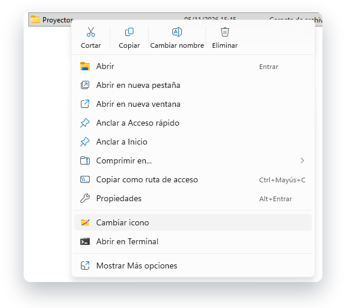
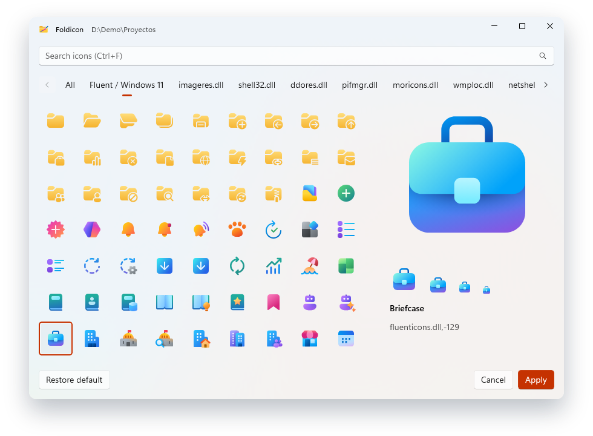
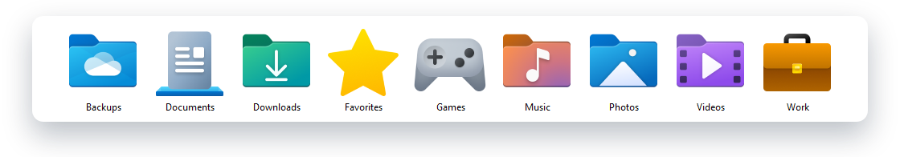

<p align="center">
  <picture>
    <source media="(prefers-color-scheme: dark)" srcset="docs/images/banner-dark.png">
    <source media="(prefers-color-scheme: light)" srcset="docs/images/banner-light.png">
    
  </picture>
</p>

<p align="center">
  Right-click a folder, choose <b>Change icon</b>, find the one you like, done.<br>
  A small, free app for Windows that puts the icons you already have to work, and adds a pack in the style of Windows 11.
</p>

<p align="center">
  <a href="../../releases/latest"></a>
  &nbsp;
  <a href="#build-from-source"></a>
</p>

<p align="center">
  <sub>Windows 10 2004 or later · x64 · Free and open source (GPL-3.0)</sub><br>
  <sub>Early development, version 0.1.0. There are no published releases yet.</sub>
</p>

<br>

<table>
  <tr>
    <td width="33%" valign="top">
      <br>
      <b>Right where you need it</b><br>
      An item in the context menu of folders, in the modern menu of Windows 11.
    </td>
    <td width="33%" valign="top">
      <br>
      <b>Search by what it shows</b><br>
      All 1,722 icons have a name in English and Spanish, so <code>music</code> and <code>música</code> both work.
    </td>
    <td width="33%" valign="top">
      <br>
      <b>See it at every size</b><br>
      A preview at 16, 24, 32, 48 and 256 px, with the name and the reference of the icon.
    </td>
  </tr>
  <tr>
    <td width="33%" valign="top">
      <br>
      <b>Easy to take back</b><br>
      <i>Restore default</i> removes only the icon and keeps every other setting of the folder.
    </td>
    <td width="33%" valign="top">
      <br>
      <b>Speaks your language</b><br>
      In Spanish on any variant of Spanish, and in English everywhere else.
    </td>
    <td width="33%" valign="top">
      <br>
      <b>Nothing to worry about</b><br>
      No network, no account, no settings. It only keeps a cache that it can rebuild.
    </td>
  </tr>
</table>

<br>

<h2 align="center">One right click away</h2>

<p align="center">
  The item sits in the modern context menu of folders, with no need to open <i>Show more options</i>.<br>
  <sub>Shown on Windows in Spanish, where it reads <b>Cambiar icono</b>.</sub>
</p>

<p align="center">
  <picture>
    <source media="(prefers-color-scheme: dark)" srcset="docs/images/shot-menu-dark.png">
    <source media="(prefers-color-scheme: light)" srcset="docs/images/shot-menu-light.png">
    
  </picture>
</p>

<h2 align="center">Find the right icon in seconds</h2>

<p align="center">
  Type what you are looking for, or browse one tab per library.<br>
  The arrows move through the grid, and <kbd>Enter</kbd> or a double click applies the icon and closes the window.
</p>

<p align="center">
  <picture>
    <source media="(prefers-color-scheme: dark)" srcset="docs/images/shot-b-search-dark.png">
    <source media="(prefers-color-scheme: light)" srcset="docs/images/shot-b-search-light.png">
    
  </picture>
</p>

<h2 align="center">The look of Windows 11, ready to use</h2>

<p align="center">
  The <b>Fluent / Windows 11</b> tab brings 224 icons of Microsoft's Fluent family: 199 in full color and 25 folders.<br>
  They come with Foldicon and look sharp at every size.
</p>

<p align="center">
  <picture>
    <source media="(prefers-color-scheme: dark)" srcset="docs/images/shot-d-fluent-dark.png">
    <source media="(prefers-color-scheme: light)" srcset="docs/images/shot-d-fluent-light.png">
    
  </picture>
</p>

<h2 align="center">Know how it will look</h2>

<p align="center">
  Check an icon at the sizes Explorer uses before you apply it.
</p>

<p align="center">
  <picture>
    <source media="(prefers-color-scheme: dark)" srcset="docs/images/shot-c-preview-dark.png">
    <source media="(prefers-color-scheme: light)" srcset="docs/images/shot-c-preview-light.png">
    
  </picture>
</p>

<h2 align="center">Folders you can tell apart</h2>

<p align="center">
  <picture>
    <source media="(prefers-color-scheme: dark)" srcset="docs/images/shot-explorer.png">
    <source media="(prefers-color-scheme: light)" srcset="docs/images/shot-explorer-light.png">
    
  </picture>
</p>

## What you get

- **Icons of Windows:** `imageres.dll`, `shell32.dll`, `ddores.dll`, `pifmgr.dll`, `moricons.dll`, `wmploc.dll`,
  `netshell.dll`, `mmcndmgr.dll` and `setupapi.dll`, from modern folders to classic pixel art.
- **Fluent icons:** 224 icons of [Fluent UI System Icons](https://github.com/microsoft/fluentui-system-icons), the 199 of
  its color set and 25 folders painted in gold so they stand out on light and dark. They also show in the search, first.
  A folder keeps its Fluent icon wherever it goes, even without Foldicon.
- **Keyboard:** <kbd>Ctrl</kbd>+<kbd>F</kbd> goes to the search box, the arrows move in the grid, <kbd>Enter</kbd>
  applies and <kbd>Esc</kbd> closes.
- **Light and dark:** the window follows the theme of the system, over Mica.

Foldicon does only this. It has no favorites, recent icons, sync or list of folders: the only files it writes are the
`desktop.ini` of the folder you change, a hidden copy of the icon in that folder when it is a Fluent one, and a cache of
the icon index in `%LOCALAPPDATA%\Foldicon`.

## Install

1. Download `Foldicon-Setup-<version>.exe` from [Releases](../../releases).
2. Run it. Windows asks once for administrator rights.
3. Right-click a folder and choose **Change icon**. If it does not show yet, sign out and in again.

The installer is not signed with a commercial certificate, so **SmartScreen may warn you** when you open it: choose
*More info* and then *Run anyway*. It also trusts a self-signed certificate on the PC, which the context menu needs, and
it removes that trust when you uninstall Foldicon from the installed apps. The item of the modern menu is per user, so
any other user of the PC has to run the installer too.

Foldicon will also be published in the Microsoft Store.

## How it works

The icon is written as `IconResource=%SystemRoot%\System32\<library>,-<id>` in the `desktop.ini` of the folder, through
`SHGetSetFolderCustomSettings`, which keeps every other setting of the file. Restoring removes only that key. See
[docs/architecture.md](docs/architecture.md).

The Fluent icons are not part of Windows, so a folder that uses one keeps its own copy, a hidden `.foldicon-<id>.ico`
next to its `desktop.ini`, and points to it by its bare name. The icon moves with the folder, stays after an update or
after you uninstall Foldicon, and works on any other PC. *Restore default* deletes the copy.

### Synced folders

Synology Drive and other sync clients carry the files of a folder, but often not the marks that make Windows read its
`desktop.ini`, so a synced folder can show the plain icon on the second PC. Open Foldicon there once: each time it
starts, it looks in your user folder, in the background, for folders with a Fluent icon and puts back what they lost.
It writes the icon again if the `desktop.ini` did not arrive. For a sync folder that lives elsewhere, choose **···** and
then *Repair all icons*, which also looks through your fixed drives. Foldicon keeps no list of your folders, and nothing
runs while it is closed.

## Build from source

You need Windows, the .NET 10 SDK and Visual Studio 2026 with the *.NET desktop development* and *Desktop development
with C++* workloads. Every dependency is free and comes from nuget.org.

```powershell
# Builds everything, including the C++ extension
& "$env:ProgramFiles\Microsoft Visual Studio\18\Community\MSBuild\Current\Bin\MSBuild.exe" Foldicon.slnx -restore -p:Configuration=Debug -p:Platform=x64

# Runs the unit tests of the core
dotnet test tests\Foldicon.Core.Tests -p:Platform=x64
```

To build the installer, run `scripts\Build-Installer.ps1`, which also needs Inno Setup 6. See
[docs/building.md](docs/building.md).

## Contributing

See [CONTRIBUTING.md](CONTRIBUTING.md). Security problems are reported as described in [SECURITY.md](SECURITY.md).

## Credits

| Project | Used for | License |
| --- | --- | --- |
| [Fluent UI System Icons](https://github.com/microsoft/fluentui-system-icons) | The icons of the Fluent / Windows 11 tab | MIT |
| [Windows App SDK](https://github.com/microsoft/WindowsAppSDK) | The window | MIT |
| [Microsoft.Data.Sqlite](https://github.com/dotnet/efcore) | The cache of the index | MIT |
| [Inter](https://github.com/rsms/inter) | The text of the images of this page | SIL OFL 1.1 |

The icons of Windows belong to Microsoft. Foldicon does not copy them: it reads them from your own system and points
your folders to them. The Fluent icons do ship with Foldicon, under the terms in
[THIRD-PARTY-NOTICES.md](THIRD-PARTY-NOTICES.md).

## License

Copyright (c) 2026 Sencimo Labs. Licensed under the [GNU General Public License, version 3](LICENSE.md)
(`GPL-3.0-only`).
