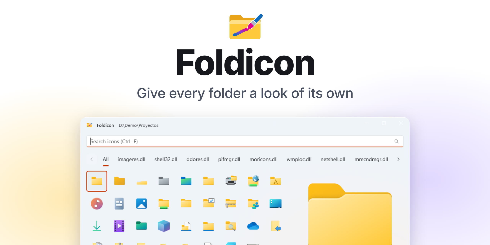
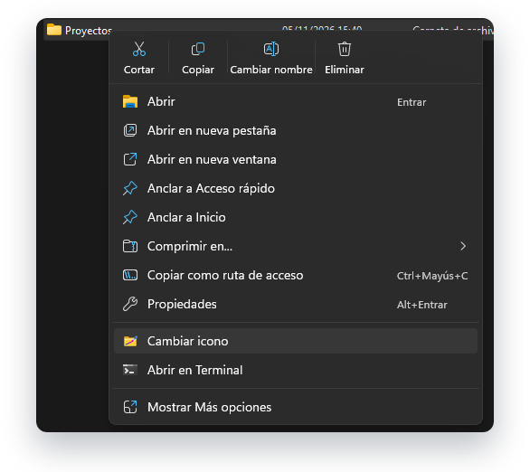
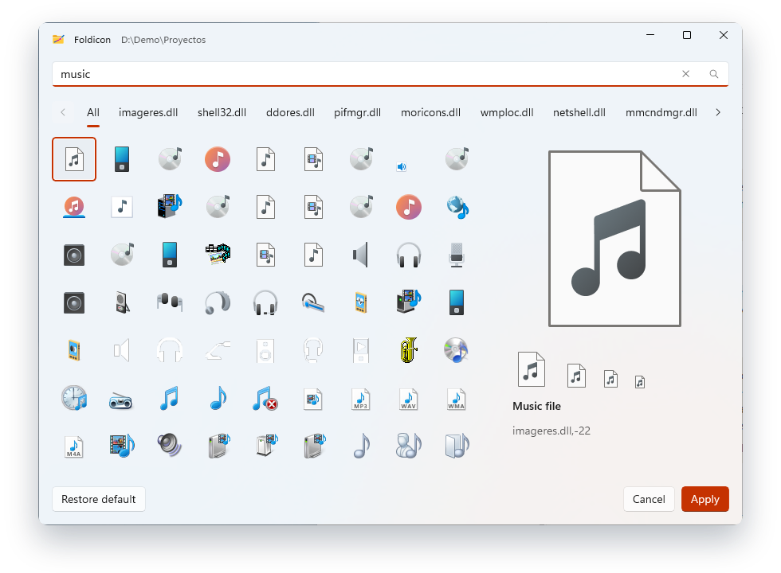
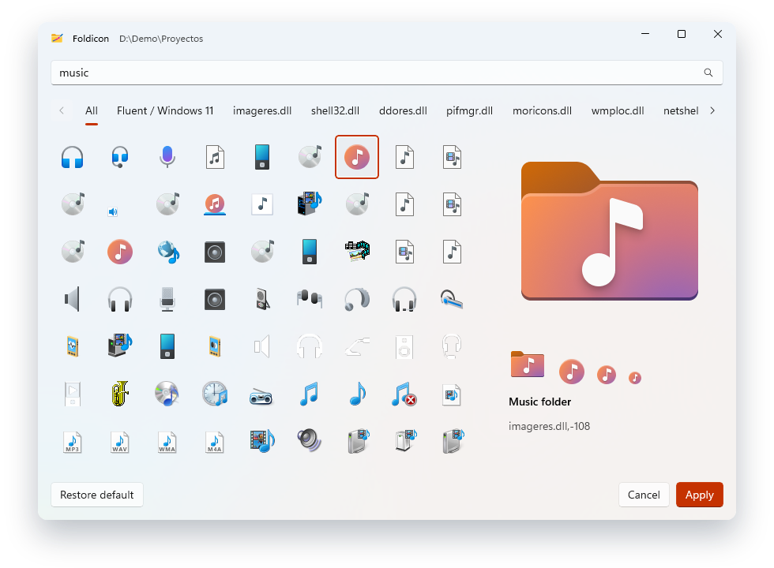
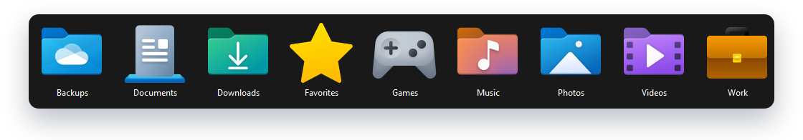

<p align="center">
  <picture>
    <source media="(prefers-color-scheme: dark)" srcset="docs/images/banner-dark.png">
    <source media="(prefers-color-scheme: light)" srcset="docs/images/banner-light.png">
    
  </picture>
</p>

<p align="center">
  Right-click a folder, choose <b>Change icon</b>, find the one you like, done.<br>
  A small, free app for Windows that puts the icons you already have to work.
</p>

<p align="center">
  <a href="../../releases/latest"></a>
  &nbsp;
  <a href="#build-from-source"></a>
</p>

<p align="center">
  <sub>Windows 10 2004 or later · x64 · Free and open source (GPL-3.0)</sub><br>
  <sub>Early development, version 0.1.0. There are no published releases yet.</sub>
</p>

<br>

<table>
  <tr>
    <td width="33%" valign="top">
      <br>
      <b>Right where you need it</b><br>
      An item in the context menu of folders, in the modern menu of Windows 11.
    </td>
    <td width="33%" valign="top">
      <br>
      <b>Search by what it shows</b><br>
      All 1,498 icons have a name in English and Spanish, so <code>music</code> and <code>música</code> both work.
    </td>
    <td width="33%" valign="top">
      <br>
      <b>See it at every size</b><br>
      A preview at 16, 24, 32, 48 and 256 px, with the name and the reference of the icon.
    </td>
  </tr>
  <tr>
    <td width="33%" valign="top">
      <br>
      <b>Easy to take back</b><br>
      <i>Restore default</i> removes only the icon and keeps every other setting of the folder.
    </td>
    <td width="33%" valign="top">
      <br>
      <b>Speaks your language</b><br>
      In Spanish on any variant of Spanish, and in English everywhere else.
    </td>
    <td width="33%" valign="top">
      <br>
      <b>Nothing to worry about</b><br>
      No network, no account, no settings. It only keeps a cache that it can rebuild.
    </td>
  </tr>
</table>

<br>

<h2 align="center">One right click away</h2>

<p align="center">
  The item sits in the modern context menu of folders, with no need to open <i>Show more options</i>.<br>
  <sub>Shown on Windows in Spanish, where it reads <b>Cambiar icono</b>.</sub>
</p>

<p align="center">
  
</p>

<h2 align="center">Find the right icon in seconds</h2>

<p align="center">
  Type what you are looking for, or browse one tab per system library.<br>
  The arrows move through the grid, and <kbd>Enter</kbd> or a double click applies the icon and closes the window.
</p>

<p align="center">
  <picture>
    <source media="(prefers-color-scheme: dark)" srcset="docs/images/shot-b-search-dark.png">
    <source media="(prefers-color-scheme: light)" srcset="docs/images/shot-b-search-light.png">
    
  </picture>
</p>

<h2 align="center">Know how it will look</h2>

<p align="center">
  Check an icon at the sizes Explorer uses before you apply it.
</p>

<p align="center">
  <picture>
    <source media="(prefers-color-scheme: dark)" srcset="docs/images/shot-c-preview-dark.png">
    <source media="(prefers-color-scheme: light)" srcset="docs/images/shot-c-preview-light.png">
    
  </picture>
</p>

<h2 align="center">Folders you can tell apart</h2>

<p align="center">
  
</p>

## What you get

- **Icons of Windows:** `imageres.dll`, `shell32.dll`, `ddores.dll`, `pifmgr.dll`, `moricons.dll`, `wmploc.dll`,
  `netshell.dll`, `mmcndmgr.dll` and `setupapi.dll`, from modern folders to classic pixel art.
- **More icons on the way:** [Fluent UI System Icons](https://github.com/microsoft/fluentui-system-icons) will be added
  as an extra source.
- **Keyboard:** <kbd>Ctrl</kbd>+<kbd>F</kbd> goes to the search box, the arrows move in the grid, <kbd>Enter</kbd>
  applies and <kbd>Esc</kbd> closes.
- **Light and dark:** the window follows the theme of the system, over Mica.

Foldicon does only this. It has no favorites, recent icons, sync or list of folders: the only file it writes besides the
`desktop.ini` of the folder you change is a cache of the icon index in `%LOCALAPPDATA%\Foldicon`.

## Install

1. Download `Foldicon-Setup-<version>.exe` from [Releases](../../releases).
2. Run it. Windows asks once for administrator rights.
3. Right-click a folder and choose **Change icon**. If it does not show yet, sign out and in again.

The installer is not signed with a commercial certificate, so **SmartScreen may warn you** when you open it: choose
*More info* and then *Run anyway*. It also trusts a self-signed certificate on the PC, which the context menu needs, and
it removes that trust when you uninstall Foldicon from the installed apps. The item of the modern menu is per user, so
any other user of the PC has to run the installer too.

Foldicon will also be published in the Microsoft Store.

## How it works

The icon is written as `IconResource=%SystemRoot%\System32\<library>,-<id>` in the `desktop.ini` of the folder, through
`SHGetSetFolderCustomSettings`, which keeps every other setting of the file. Restoring removes only that key. See
[docs/architecture.md](docs/architecture.md).

## Build from source

You need Windows, the .NET 10 SDK and Visual Studio 2026 with the *.NET desktop development* and *Desktop development
with C++* workloads. Every dependency is free and comes from nuget.org.

```powershell
# Builds everything, including the C++ extension
& "$env:ProgramFiles\Microsoft Visual Studio\18\Community\MSBuild\Current\Bin\MSBuild.exe" Foldicon.slnx -restore -p:Configuration=Debug -p:Platform=x64

# Runs the unit tests of the core
dotnet test tests\Foldicon.Core.Tests -p:Platform=x64
```

To build the installer, run `scripts\Build-Installer.ps1`, which also needs Inno Setup 6. See
[docs/building.md](docs/building.md).

## Contributing

See [CONTRIBUTING.md](CONTRIBUTING.md). Security problems are reported as described in [SECURITY.md](SECURITY.md).

## Credits

| Project | Used for | License |
| --- | --- | --- |
| [Fluent UI System Icons](https://github.com/microsoft/fluentui-system-icons) | Extra source of icons (coming soon) | MIT |
| [Windows App SDK](https://github.com/microsoft/WindowsAppSDK) | The window | MIT |
| [Microsoft.Data.Sqlite](https://github.com/dotnet/efcore) | The cache of the index | MIT |
| [Inter](https://github.com/rsms/inter) | The text of the images of this page | SIL OFL 1.1 |

The icons of Windows belong to Microsoft. Foldicon does not copy them: it reads them from your own system and points
your folders to them.

## License

Copyright (c) 2026 Sencimo Labs. Licensed under the [GNU General Public License, version 3](LICENSE.md)
(`GPL-3.0-only`).
